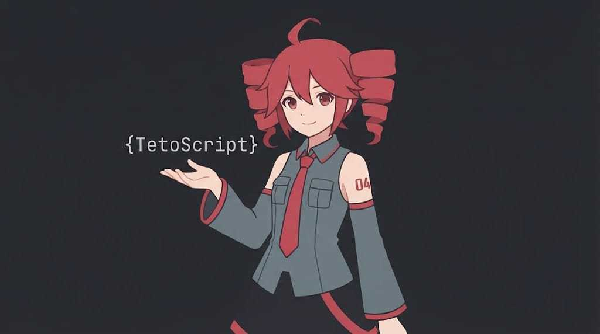

# TetoScript

<p align="center"></p>

**Un lenguaje propio inspirado en Kasane Teto**, con una sintaxis distintiva y familiar para quienes conocen TypeScript. El repositorio contiene un intérprete experimental escrito en Python; no es TypeScript, no es compatible con su ecosistema y aún no es un reemplazo listo para producción.

## Ejemplo ejecutable

```teto
teto nombre: string = "Teto"
teto edad: number = 25

teto fn saludo(persona: string) -> string {
    return "Hola, " + persona + "!"
}

Teto (edad % 2 == 1) {
    tetolog(saludo(nombre))
} else {
    tetolog("nose")
}
```

La palabra `Teto` identifica el condicional; `teto` introduce variables y funciones; `tetolog` es la salida; `nose` representa ausencia de valor. El operador `%` es módulo numérico. Para imprimir una frase que contenga `%`, escríbela como texto entre comillas, por ejemplo `tetolog("Teto%Teto25")`.

## Ejecutar

Requiere Python 3.10 o posterior, sin dependencias externas. Desde la raíz:

```sh
PYTHONPATH=src python -m tetoscript examples/hello.teto
```

Instalación editable y comando `teto`:

```sh
python -m pip install -e .
teto examples/hello.teto
teto check examples/hello.teto
```

`check` analiza sintaxis, nombres y tipos básicos sin ejecutar el programa. Por ejemplo, reporta si se usa una variable inexistente o se pasa un texto donde una función requiere un número.

Pruebas:

```sh
python -m unittest discover -s tests -v
```

## Estado del proyecto

La versión `0.5.0` ya ejecuta variables, anotaciones básicas comprobadas en runtime, funciones, retorno, expresiones aritméticas y lógicas, condicionales, comentarios y salida. `teto check` analiza nombres y tipos antes de ejecutar: detecta identificadores no definidos, incompatibilidades de tipos, argumentos incorrectos y retornos incompatibles. Todavía faltan módulos, colecciones, análisis de todas las rutas de retorno, herramientas de desarrollo y un compilador. No se declara reemplazo de TypeScript ni lenguaje estable.

Consulta [docs/syntax.md](docs/syntax.md) para la sintaxis implementada. La licencia sigue pendiente: no se asigna una licencia sin decidirla explícitamente.
